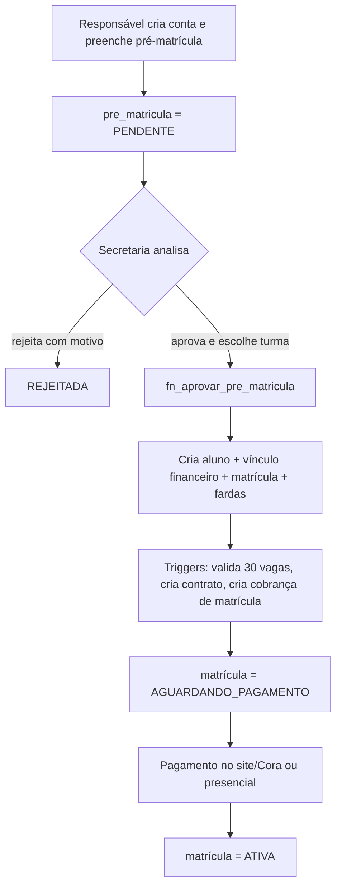
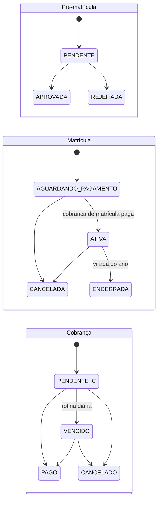

# 01 — Negócio: o que o sistema faz

> Consolida `Requisitos.pdf`, `MODELO.md` e a documentação do banco. Este é o documento de referência para **o quê** construir; os documentos 03 a 05 dizem **como**.

---

## 1. Visão geral

Sistema web de gestão escolar para o **Centro Educacional Semeando** (Maternal 1 ao 5º ano). Automatiza o ciclo completo do aluno: pré-matrícula online → aprovação → matrícula → cobrança mensal → vida pedagógica → rematrícula no ano seguinte. Também controla bolsas, funcionários e obrigações da escola com órgãos externos.

A escola tem dois níveis de ensino, e **quase toda regra de cobrança e contrato depende do nível**:

| Nível | Séries | Cobrança mensal | Documento de formalização |
|---|---|---|---|
| Educação Infantil | Maternal 1, Maternal 2, Infantil 1, Infantil 2 | **Taxa de Associado** | **Ficha de Sócio** |
| Ensino Fundamental | 1º ao 5º ano | **Mensalidade** (boleto) | **Contrato de Matrícula** |

## 2. Perfis de usuário

| Perfil (enum `perfil_usuario`) | O que faz | Área do sistema |
|---|---|---|
| `ADMIN` (Administrador / Gestor) | Acesso irrestrito: configurações, financeiro, usuários | Área da escola |
| `SECRETARIA` | Alunos, aprovação de matrículas, turmas, documentos, obrigações | Área da escola |
| `FINANCEIRO` | Pagamentos, taxas, boletos, bolsas, inadimplência | Área da escola |
| `PROFESSOR` | Só as próprias turmas: diário, frequência, planejamento | Área da escola |
| `RESPONSAVEL` | Portal: dados dos filhos, notas, pagamentos, contratos, pré-matrícula e rematrícula | Portal |
| `ALUNO` | Portal: notas e documentos (pouco usado, público até o 5º ano) | Portal |

Matriz de permissões por módulo (tabela `perfil_permissao`, L = lê, G = grava):

| Módulo | ADMIN | SECRETARIA | FINANCEIRO | PROFESSOR | RESPONSAVEL | ALUNO |
|---|---|---|---|---|---|---|
| CONFIGURACOES | LG | — | — | — | — | — |
| USUARIOS | LG | — | — | — | — | — |
| MATRICULA | LG | LG | L | — | — | — |
| ALUNOS | LG | LG | L | L | — | — |
| TURMAS | LG | LG | — | L | — | — |
| DOCUMENTOS | LG | LG | — | — | — | — |
| FINANCEIRO | LG | — | LG | — | — | — |
| BOLSAS | LG | — | LG | — | — | — |
| RH | LG | — | — | — | — | — |
| PEDAGOGICO | LG | L | — | LG | — | — |
| OBRIGACOES | LG | LG | — | — | — | — |
| PORTAL | LG | — | — | — | LG | L |

> O professor tem ainda um **filtro de dados**: só enxerga as turmas em que está vinculado (`turma_professor`). O responsável só enxerga os alunos a que está vinculado (`aluno_responsavel`). Esses filtros são aplicados **na aplicação Java**.

---

## 3. Requisitos funcionais (RF)

| RF | Descrição | Escopo da 1ª entrega |
|---|---|---|
| **RF01** | **Matrícula e rematrícula** | ✅ |
| RF01.1 | Pré-matrícula preenchida online pelo responsável | ✅ |
| RF01.2 | Secretaria aprova ou rejeita; aprovada vira cadastro principal | ✅ |
| RF01.3 | Coleta do tamanho de farda: uniforme e educação física, separados | ✅ |
| RF01.4 | Emissão de Contrato de Matrícula (Fundamental) ou Ficha de Sócio (Infantil) | ✅ (registro); PDF depois |
| RF01.5 | Fluxo de rematrícula para alunos de anos anteriores | ✅ |
| RF01.6 | Cadastro único por aluno; rematrícula não cria novo cadastro | ✅ |
| **RF02** | **Bolsas de estudo** refletindo automaticamente na cobrança mensal | ✅ |
| **RF03** | **Capacidade de turmas**: até 30 alunos, com aviso à secretaria | ✅ |
| **RF04** | **Financeiro com integração Cora**: Taxa de Associado (Infantil), Mensalidade (Fundamental), pagamento da matrícula no site ou presencial | ✅ (baixa manual); Cora depois |
| **RF05** | **Notificações de cobrança**: vencimento próximo e inadimplência | Fila no banco ✅; envio real depois |
| **RF06** | **Lista de materiais** por série no portal | ✅ |
| **RF07** | **RH**: cadastro de administrativos, professores, gestores e prestadores | ✅ |
| **RF08** | **Pedagógico**: diário de classe e frequência (08.1), plano de aula e planejamento diário (08.2), calendário letivo (08.3), formação continuada (08.4) | 2ª entrega |
| **RF09** | **Obrigações institucionais**: Censo/INEP (junho), SMTT (março), Sistema Presença (a cada 2 meses), Cora — com documentos e alertas | 2ª entrega |
| **RF10** | **Portal do responsável/aluno**: dados, notas, documentos, materiais, pagamentos, assinatura de contratos | ✅ (parcial) |

---

## 4. Regras de negócio

Numeração unificada. **RN01–RN04** vêm dos requisitos, **RN05–RN13** do `MODELO.md` (contrato e anexo didático), **RD01–RD07** são regras derivadas que o banco assumiu.

A coluna **Onde** diz quem garante a regra: **Banco** (trigger/constraint/função), **Model** (Java) ou **Ambos** (aplicação Java valida cedo para dar boa mensagem, banco é a garantia final).

| ID | Regra | Onde |
|---|---|---|
| RN01 | Uma única cobrança mensal por aluno: Infantil → Taxa de Associado; Fundamental → Mensalidade | Banco (`uq_cobranca_mensal`, `fn_cobranca_before_insert`) |
| RN02 | Aluno ↔ Responsável é muitos-para-muitos | Banco (`aluno_responsavel`) |
| RN03 | Cadastro único por aluno; renovação anual é rematrícula; no máximo uma matrícula por ano | Banco (`uq_matricula_aluno_ano`, `fn_rematricular`) |
| RN04 | Máximo de 30 alunos por turma; ao lotar, avisar a secretaria e bloquear novas matrículas | Ambos (`Turma.temVaga()` + `fn_matricula_before`, `alerta_secretaria`) |
| RN05 | Pré-matrícula feita pelo responsável; secretaria aprova ou rejeita; aprovada vira cadastro principal | Banco (`fn_aprovar_pre_matricula`) |
| RN06 | Coletar tamanho de farda de uniforme e de educação física, separados | Banco (`farda_matricula`) |
| RN07 | Infantil formaliza com Ficha de Sócio; Fundamental com Contrato | Banco (`fn_matricula_after_insert`) |
| RN08 | **Desconto de 10%** se pago até o vencimento (Mensalidade) | **Model** (não existe no banco) |
| RN09 | Atraso: **multa de 2% + juros de 0,033% ao dia**; sem acréscimo se pago até o **5º dia útil** do mês de vencimento | **Model** (não existe no banco) |
| RN10 | Atraso ≥ 30 dias: correção pelo INPC *(opcional nesta etapa)* | Model (futuro) |
| RN11 | Bolsa concedida a critério da escola, revogável a cada ano letivo, reflete no valor da cobrança | Banco (`fn_desconto_bolsa`, recálculo por trigger) |
| RN12 | Matrícula só é efetivada com a **1ª parcela paga** e documentos entregues | Banco (pagamento ativa a matrícula) + **Model** (checagem de documentos) |
| RN13 | Só se aceita/renova matrícula de aluno **adimplente** | **Model** (checar `vw_inadimplencia` antes de rematricular) |
| RD01 | Todo aluno tem exatamente um responsável financeiro, que recebe as cobranças | Banco (`uq_aluno_resp_financeiro`) |
| RD02 | A matrícula só é ativada quando a cobrança de matrícula é paga (site ou presencial) | Banco (`fn_cobranca_after_update`) |
| RD03 | Só um responsável vinculado ao aluno pode assinar o contrato | Banco (`fn_valida_assinante`) |
| RD04 | Pré-matrícula decidida não volta a pendente; rejeitar exige motivo | Banco (`fn_pre_matricula_decisao`, CHECK) |
| RD05 | Cobrança paga não pode ser alterada nem excluída | Banco (triggers de cobrança) |
| RD06 | Desconto de bolsa só nas cobranças mensais, nunca na matrícula, limitado ao valor bruto | Banco (`fn_desconto_bolsa`) |
| RD07 | Professor só lança diário e plano nas turmas a que está vinculado | Banco (`fn_valida_professor_turma`) |

### 4.1 Tabela de valores (anexo didático)

| Etapa / Série | Valor mensal | Com desconto de 10% (RN08) |
|---|---|---|
| Educação Infantil (todas) | Taxa de associado R$ 125,00 | — (não se aplica) |
| 1º ano | R$ 310,00 | R$ 279,00 |
| 2º ao 5º ano | R$ 375,00 | R$ 337,00 ⚠️ (10% daria R$ 337,50 — ver seção 8) |
| Jiu Jitsu / Ballet (atividade extra) | R$ 50,00 | — |

Os valores **nunca são digitados** em contrato ou cobrança: vêm sempre de `tabela_preco` (por série e ano letivo).

### 4.2 Documentos obrigatórios da matrícula (RN12)

1. Identidade e CPF dos pais/responsáveis
2. Certidão de nascimento (ou RG e CPF) da criança
3. Carteira de vacinação
4. Comprovante de residência
5. Declaração de adimplência (alunos vindos de outra escola particular)
6. 2 fotos 3x4
7. Documento das pessoas autorizadas a buscar a criança

### 4.3 Cálculo do valor a pagar de uma cobrança mensal

Ordem de aplicação (o banco faz os passos 1–2; a aplicação Java faz o 3):

1. **Valor bruto** = `tabela_preco.valor_mensal` da série/ano.
2. **Valor final** = bruto − desconto de bolsa (RN11/RD06). Gravado em `cobranca.valor_final`.
3. **Valor a pagar na data D** (RN08/RN09):
   - D ≤ vencimento e tipo permite desconto de pontualidade → `valor_final × 0,90`;
   - D ≤ 5º dia útil do mês do vencimento → `valor_final` (sem acréscimo);
   - depois disso → `valor_final + 2% de multa + 0,033% × dias de atraso`.

> ⚠️ A combinação de desconto de 10% + bolsa e a regra de arredondamento precisam de confirmação (ver seção 8).

---

## 5. Fluxos principais

### 5.1 Pré-matrícula até matrícula ativa

### 5.2 Rematrícula

Responsável (ou secretaria) escolhe a turma do ano seguinte → aplicação Java confere adimplência (RN13) → `fn_rematricular` reaproveita o cadastro do aluno, cria matrícula do tipo `REMATRICULA`, contrato e cobrança de matrícula → pagamento ativa. A matrícula do ano anterior vira `ENCERRADA` na virada do ano (`fn_encerrar_ano_letivo`).

### 5.3 Cobrança mensal

Todo dia 25 um job gera as cobranças do mês seguinte para toda matrícula `ATIVA` (bolsa aplicada automaticamente) → aplicação Java emite boleto no Cora e grava `cora_id`/`cora_url` → pagamento via webhook do Cora ou baixa presencial → rotina diária marca vencidas e cria notificações.

### 5.4 Ciclos de vida

(`PENDENTE_C` = `PENDENTE` da cobrança. `PAGO` é imutável.)

Obrigação institucional: `PENDENTE → ATRASADA` (prazo passou) e `PENDENTE/ATRASADA → CUMPRIDA` (sem periodicidade) ou de volta a `PENDENTE` com nova data (com periodicidade).

---

## 6. Rastreabilidade: requisito → aplicação Java → tela → banco

| RF | Pacote no Model/Controller | Telas principais | Objetos do banco |
|---|---|---|---|
| RF01 | `matricula` | Pré-matrícula (portal), Fila de pré-matrículas, Matrículas, Rematrícula | `pre_matricula`, `matricula`, `farda_matricula`, `contrato`, `fn_aprovar_pre_matricula`, `fn_rematricular` |
| RF02 | `financeiro` | Bolsas, Bolsas do aluno | `bolsa`, `bolsa_matricula`, `vw_bolsistas` |
| RF03 | `academico` | Turmas (ocupação), Alertas | `turma`, `vw_vagas_turma`, `alerta_secretaria` |
| RF04 | `financeiro` | Cobranças, Baixa de pagamento, Resumo mensal | `cobranca`, `fn_registrar_pagamento*`, `vw_resumo_financeiro_mensal` |
| RF05 | `financeiro` | Inadimplência | `notificacao_cobranca`, `vw_inadimplencia` |
| RF06 | `academico` | Listas de materiais, Materiais (portal) | `lista_material`, `item_material`, `vw_portal_materiais` |
| RF07 | `pessoas` | Funcionários | `funcionario`, `formacao_continuada` |
| RF08 | `pedagogico` | Minhas turmas, Diário, Frequência, Planos, Calendário | `diario_classe`, `frequencia`, `plano_aula`, `calendario_letivo` |
| RF09 | `institucional` | Obrigações | `obrigacao_institucional`, `vw_alertas_obrigacoes` |
| RF10 | `portal` | Portal (início, filhos, cobranças, notas, contratos, documentos) | `vw_portal_*` |

---

## 7. Glossário

| Termo | Significado |
|---|---|
| Competência | Mês a que a cobrança se refere (sempre dia 1 no banco) |
| Taxa de Associado | Cobrança mensal da Educação Infantil |
| Mensalidade | Cobrança mensal (boleto) do Ensino Fundamental |
| Ficha de Sócio | Documento de formalização da Educação Infantil |
| Contrato de Matrícula | Documento de formalização do Ensino Fundamental |
| Responsável financeiro | O responsável que recebe as cobranças; um por aluno |
| Rematrícula | Matrícula de aluno que já tem cadastro de ano anterior |
| Cora | Banco digital usado para boletos e conciliação |
| Censo/INEP | Declaração anual ao INEP (junho) |
| SMTT | Órgão municipal de trânsito; obrigação anual (março) |
| Sistema Presença | Envio de frequência a cada 2 meses |
| Arras | 1ª parcela paga na matrícula, que a efetiva |

---

## 8. Inconsistências nos documentos (decidir com o professor)

| # | Problema | Decisão provisória |
|---|---|---|
| 1 | Contrato: anuidade R$ 3.720,00 em "11 parcelas de R$ 310,00" = R$ 3.410,00 (12 × 310 = 3.720) | Gerar mensalidades pelo ano letivo do banco (fev–dez = 11 meses) e confirmar |
| 2 | Contrato usa R$ 310,00 para o 3º ano; a tabela diz R$ 375,00 (2º–5º) | Valor sempre vem de `tabela_preco` |
| 3 | 10% de R$ 375,00 = R$ 337,50, mas a tabela diz R$ 337,00 | Arredondamento concentrado em uma única classe (`Dinheiro`), fácil de trocar |
| 4 | Cláusula 17 do contrato cita um "Anexo I" que não existe | Ignorar |
| 5 | Endereço da escola difere entre documentos | Não usar como dado fixo; vai para configuração |
| 6 | Desconto de 10% (até o vencimento) × carência até o 5º dia útil | Implementado como descrito na seção 4.3; confirmar |
| 7 | `MODELO.md` usa herança `Pessoa`; o banco usa três tabelas separadas | Herança só no Java; banco não muda (ver [04-model-controller.md](04-model-controller.md)) |
| 8 | Valor da cobrança de matrícula não está definido | Provisório: igual à 1ª parcela (RN12) |

---

## 9. Dados sensíveis e LGPD

- **Proibido usar dados reais** (LGPD art. 14, dados de crianças). Testes e demonstrações usam **dados sintéticos** (CPF `00000000000`, nomes fictícios).
- Dados sensíveis: ficha de saúde do aluno (deficiência, alergia, restrição alimentar, acompanhamento), autodeclaração étnico-racial do funcionário, CPF e dados financeiros. **Nunca** aparecem em logs, `toString()`, mensagens de erro ou URLs.
- Registrar consentimento de uso de imagem (`autorizaUsoImagem`).
- Acesso ao banco **somente pela aplicação Java**; a View nunca fala direto com as tabelas.
- Arquivos (documentos, contratos) ficam em buckets **privados** e são servidos por URL assinada de curta duração.
