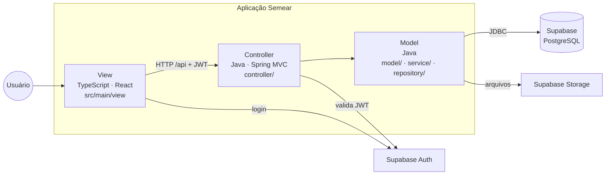
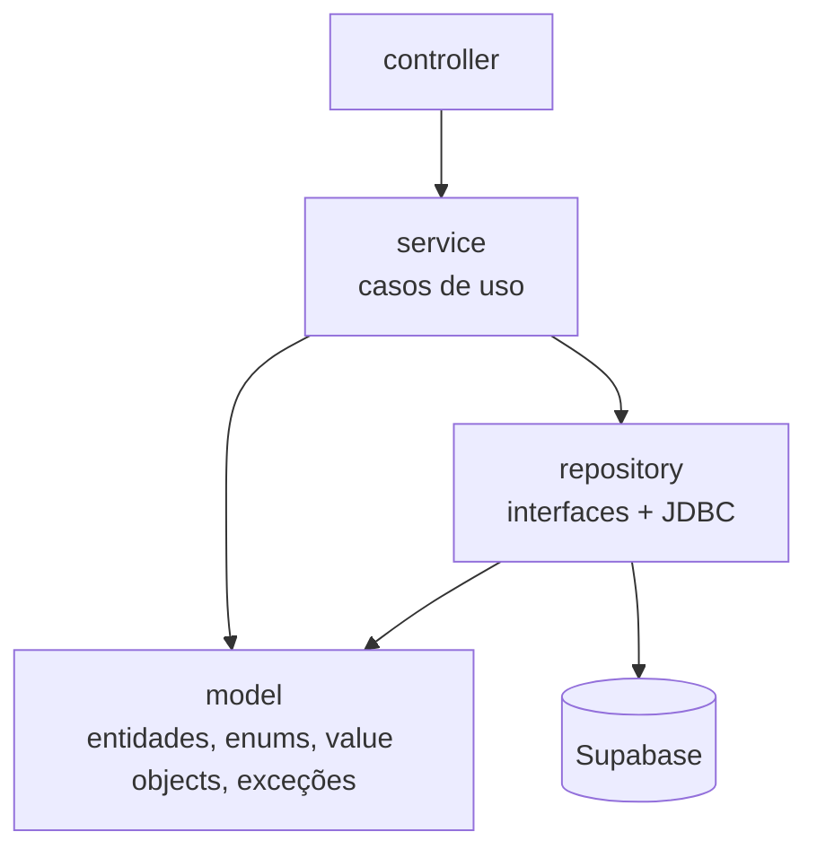

# 02 — Arquitetura (MVC)

> Como as peças se encaixam. Detalhes de cada camada em [03-banco-de-dados.md](03-banco-de-dados.md), [04-model-controller.md](04-model-controller.md) e [05-view.md](05-view.md).

---

## 1. Padrão MVC

O sistema é **uma única aplicação** organizada em **Model–View–Controller**:

| Camada MVC | Linguagem | Onde fica | Responsabilidade |
|---|---|---|---|
| **Model** | Java | `src/main/java/br/undb/semear/model`, `service`, `repository` | Entidades do domínio, regras de negócio, acesso ao banco |
| **Controller** | Java | `src/main/java/br/undb/semear/controller` | Recebe as requisições HTTP, valida a entrada, chama o Model e devolve JSON |
| **View** | TypeScript (React) | `src/main/view` | Telas que o usuário vê; consome os Controllers |



Fluxo de uma ação: o usuário interage com a **View** → a View chama um endpoint → o **Controller** valida e delega → o **Model** aplica as regras e persiste → o Controller devolve a resposta → a View se atualiza.

**Regras do MVC neste projeto:**
- a **View** não conhece o banco nem regras de negócio; só exibe e envia dados ao Controller;
- o **Controller** não contém regra de negócio nem SQL; só traduz HTTP ↔ Model;
- o **Model** não conhece HTTP nem a View; é Java puro testável sem servidor;
- a View usa o Supabase **apenas para login**; todo dado passa pelo Controller.

### Divisão interna do Model

O Model é a camada mais rica. Ela se divide em três partes:



| Pacote | Conteúdo | Depende de |
|---|---|---|
| `model` | Entidades (`Aluno`, `Turma`, `Cobranca`…), enums, value objects (`Dinheiro`, `Cpf`), exceções | nada (Java puro) |
| `repository` | Interfaces `Repository<T,ID>` e implementações JDBC | `model` |
| `service` | Casos de uso que orquestram entidades e repositórios | `model`, `repository` |
| `dto` | Objetos de entrada/saída dos Controllers (`record`) | `model` |
| `controller` | Endpoints REST | `service`, `dto` |

---

## 2. Stack

| Camada | Tecnologia | Motivo |
|---|---|---|
| Model + Controller | **Java 21** + Spring Boot 3 (Spring MVC, Spring JDBC, Spring Security) | POO (requisito da disciplina), tipagem forte |
| View | **TypeScript** + React 19 + Vite | Tipagem também na interface; padrão de mercado |
| UI | Tailwind CSS + shadcn/ui | Componentes acessíveis |
| Estado da View | TanStack Query, React Hook Form + Zod | Cache de requisições e validação |
| Banco | Supabase (PostgreSQL 17) | Já definido; esquema aplicado |
| Autenticação | Supabase Auth | Login, recuperação de senha, sessão |
| Arquivos | Supabase Storage (buckets privados) | Documentos e contratos |
| Agendamento | `pg_cron` | Rotina diária e geração mensal |
| Build | Maven (Java) + npm (TypeScript), no mesmo projeto | Um único artefato final |
| Testes | JUnit 5 + AssertJ (Java), Vitest (TypeScript) | Teste por regra de negócio |

> **Por que JDBC e não JPA?** O banco usa 20 tipos `ENUM` do Postgres, índices parciais e triggers que alteram linhas sozinhos (ex.: ativar matrícula ao pagar). Com JDBC, cada repositório é uma classe explícita, o Model fica livre de anotações de ORM e o encapsulamento fica visível.

---

## 3. Estrutura do projeto

Padrão Maven (`src/main`, `src/test`) com a View dentro do mesmo projeto:

```
semear/
├── pom.xml                        # build Java (Etapa 0)
├── package.json                   # build TypeScript (Etapa 0)
├── vite.config.ts                 # compila src/main/view → target/classes/static
├── tsconfig.json
├── .env.example                   # variáveis de toda a aplicação
├── .mcp.json                      # conexão do Claude Code com o Supabase
├── docs/                          # esta documentação
├── infosystem/                    # fontes originais (somente leitura)
├── supabase/
│   ├── migrations/                # histórico do esquema do banco
│   └── seed.sql                   # dados fictícios de desenvolvimento
└── src/
    ├── main/
    │   ├── java/br/undb/semear/
    │   │   ├── SemearApplication.java
    │   │   ├── config/            # configurações Spring (CORS, Jackson, OpenAPI, Supabase)
    │   │   ├── controller/        # ── C ──  um subpacote por módulo + advice/
    │   │   ├── dto/               # entrada e saída dos controllers, por módulo
    │   │   ├── service/           # ── M ──  casos de uso, por módulo
    │   │   ├── model/             # ── M ──  domínio
    │   │   │   ├── entity/        #          entidades, por módulo
    │   │   │   ├── enums/
    │   │   │   ├── valueobject/
    │   │   │   └── exception/
    │   │   ├── repository/        # ── M ──  persistência, por módulo + base/
    │   │   ├── security/          # autenticação JWT e permissões
    │   │   └── integration/       # supabase/, cora/, notificacao/
    │   ├── resources/
    │   │   └── application.yml
    │   └── view/                  # ── V ──  TypeScript (React)
    │       ├── index.html
    │       ├── main.tsx
    │       ├── app/  pages/  components/  layouts/
    │       ├── services/  models/  hooks/  auth/  lib/  config/  styles/
    └── test/
        ├── java/br/undb/semear/   # model/, service/, controller/
        └── view/                  # testes da View
```

**Módulos do domínio** (repetidos como subpacote em `controller`, `dto`, `service`, `repository` e `model/entity`):
`pessoa` · `academico` · `matricula` · `financeiro` · `pedagogico` · `institucional` · `portal` (este sem entidades próprias: só leitura).

Exemplo do mesmo assunto atravessando as camadas:

| Camada | Arquivo |
|---|---|
| View | `src/main/view/pages/escola/matricula/FilaPreMatriculas.tsx` |
| View → API | `src/main/view/services/PreMatriculaService.ts` |
| Controller | `controller/matricula/PreMatriculaController.java` |
| DTO | `dto/matricula/AprovarPreMatriculaRequest.java` |
| Service | `service/matricula/PreMatriculaService.java` |
| Model | `model/entity/matricula/PreMatricula.java` |
| Repository | `repository/matricula/PreMatriculaRepository.java` + `PreMatriculaJdbcRepository.java` |

---

## 4. Build e execução

| Situação | Como funciona |
|---|---|
| **Desenvolvimento** | Dois processos: `mvn spring-boot:run` (Model + Controller na porta 8080) e `npm run dev` (View na porta 5173, com *proxy* de `/api` para 8080) |
| **Entrega / produção** | `npm run build` gera a View em `target/classes/static`; `mvn package` gera **um único `.jar`** que serve a View e a API no mesmo endereço |

Como a View e a API ficam na mesma origem em produção, não há problema de CORS, e `VITE_API_URL=/api` funciona nos dois ambientes.

---

## 5. Fluxo de uma requisição autenticada

```mermaid
sequenceDiagram
    participant U as Usuário
    participant V as View (TS)
    participant SA as Supabase Auth
    participant C as Controller (Java)
    participant S as Service (Java)
    participant DB as Postgres

    U->>V: e-mail + senha
    V->>SA: signInWithPassword
    SA-->>V: access_token (JWT, sub = auth.users.id)
    V->>C: POST /api/pre-matriculas/{id}/aprovar (Bearer JWT)
    C->>C: Spring Security valida JWT (JWKS) e permissão MATRICULA:GRAVAR
    C->>S: aprovar(id, turmaId, usuarioLogado)
    S->>S: preMatricula.validarAprovacao(turma); turma.garantirVaga()
    S->>DB: SELECT fn_aprovar_pre_matricula(...)
    DB-->>S: id da matrícula (ou exceção "Turma lotada")
    S-->>C: matrícula criada
    C-->>V: 201 Created / 409 {codigo: "TURMA_LOTADA"}
```

---

## 6. Divisão de responsabilidades: banco × Model

| Responsabilidade | Banco | Model (Java) |
|---|---|---|
| Integridade (FK, UNIQUE, CHECK) | ✅ garante | valida cedo para dar mensagem amigável |
| Fluxos transacionais (aprovar, rematricular, pagar) | ✅ funções `fn_*` | o Service chama a função |
| Limite de 30 por turma sob concorrência | ✅ trava de linha | `Turma.garantirVaga()` para feedback |
| Desconto de bolsa | ✅ calcula e grava | exibe |
| Desconto de pontualidade, multa, juros (RN08–RN10) | — | ✅ `Cobranca.valorAPagar()` |
| Documentos obrigatórios (RN12), adimplência (RN13) | — | ✅ Services de matrícula |
| Autorização por perfil e filtro por dono do dado | — | ✅ `security` + Services |
| Cora, notificações, PDF, upload | registra estado | ✅ `integration` |

---

## 7. Decisões de arquitetura (registro)

| # | Decisão | Alternativa descartada | Motivo |
|---|---|---|---|
| D01 | Aplicação única em **MVC**; a View só acessa dados pelos Controllers | View acessando o Supabase direto com RLS | POO no centro, segurança LGPD, regras em um só lugar |
| D02 | Supabase Auth; `usuario.id = auth.users.id` | Senha com hash próprio | Recuperação de senha e sessão prontas |
| D03 | Spring JDBC em vez de JPA | Hibernate | Enums do Postgres, triggers, Model limpo |
| D04 | Herança `Pessoa` só no Java | Tabela `pessoa` única | Banco já modelado com três tabelas |
| D05 | Mudanças no banco só por novas migrations | Editar o script | Histórico rastreável |
| D06 | Services chamam as funções `fn_*` do banco | Reimplementar inserts | Transação e regras já no banco |
| D07 | Arquivos em buckets privados com URL assinada | Buckets públicos | Documentos de crianças |
| D08 | Projeto único (Maven + Vite), pacotes **por camada MVC** com subpacotes por módulo | Dois projetos separados | Padrão MVC explícito; um artefato de entrega |
| D09 | Nomes de camadas em inglês (`model`, `controller`, `service`…); nomes do domínio em português (`Matricula`, `Cobranca`) | Tudo em português | Convenção de mercado para a arquitetura, vocabulário da escola para o negócio |
| D10 | Conta do responsável criada pela aplicação Java já confirmada (`POST /api/publico/contas` → `ProvedorIdentidade` → `SupabaseAuthAdmin`), com limite de 5 tentativas por IP/hora | `supabase.auth.signUp` com confirmação por e-mail | Projeto acadêmico sem servidor de e-mail (o SMTP padrão do Supabase só entrega para a equipe). **Em produção:** configurar SMTP próprio e voltar à confirmação por e-mail. A recuperação de senha continua dependendo de e-mail |
| D12 | Cora simulado (`CORA_MODO=falso`): `CoraGatewayFalso` gera id/URL fictícios, o link de pagamento leva à tela de boleto do portal e o webhook segue o contrato real (HMAC-SHA256). O valor pago é o calculado pelo Model na data (RN08/RN09) | Esperar o sandbox do Cora | Permite demonstrar o ciclo completo (gerar → boleto → pagar → baixa) sem conta no banco. Trocar pela integração real é uma nova classe de `CoraGateway` |
| D13 | Valor a pagar calculado só no Model (`Cobranca.calcular`, Template Method + `RegraEncargos` Strategy; `SemEncargos` como Null Object na matrícula) e gravado em `valor_pago` na baixa | Função no banco | RN08/RN09 não existem no banco; ter uma única implementação evita divergência entre tela e baixa |
| D14 | Obrigação só pode ser marcada como cumprida com comprovante enviado no ciclo atual; comprovante de ciclo cumprido vira histórico (não se apaga) | Cumprir sem prova | RF09 pede "documentos"; evita marcar cumprida sem evidência para fiscalização |
| D15 | Tarefas agendadas na aplicação (`AgendamentoFinanceiro`: boletos, avisos, rotina diária às 06h e cobranças do mês seguinte no dia 25) em vez do `pg_cron` | `pg_cron` no Supabase | A extensão não está ativa no projeto; as funções são idempotentes, então ativar o `pg_cron` depois não causa duplicidade |
| D16 | Contrato assinado guarda o texto e os valores congelados (jsonb + SHA-256) e a evidência (canal, IP e navegador, ou funcionário no presencial); ações sensíveis guardam o funcionário (baixa presencial, cumprimento de obrigação, bolsa) | Recalcular o texto sempre | Um reajuste não pode mudar o que o responsável aceitou; auditoria mínima de quem fez o quê |
| D17 | Conexões ao banco em `America/Fortaleza` (`connection-init-sql`) | Deixar em UTC | Com o banco em UTC, `current_date` virava o dia seguinte depois das 21h de São Luís (vencidas, inadimplência, obrigações) |
| D11 | Permissões por perfil editáveis pelo gestor (`perfil_permissao`), com cópia do padrão em `perfil_permissao_padrao` para "Restaurar padrão" | Permissões fixas no código | Orientação do prof. Gusmão (28/10/2026): perfil por setor/cargo com padrão, e o gestor desliga o que quiser. `MatrizPermissoes` impede o ADMIN de perder Configurações e Usuários |
