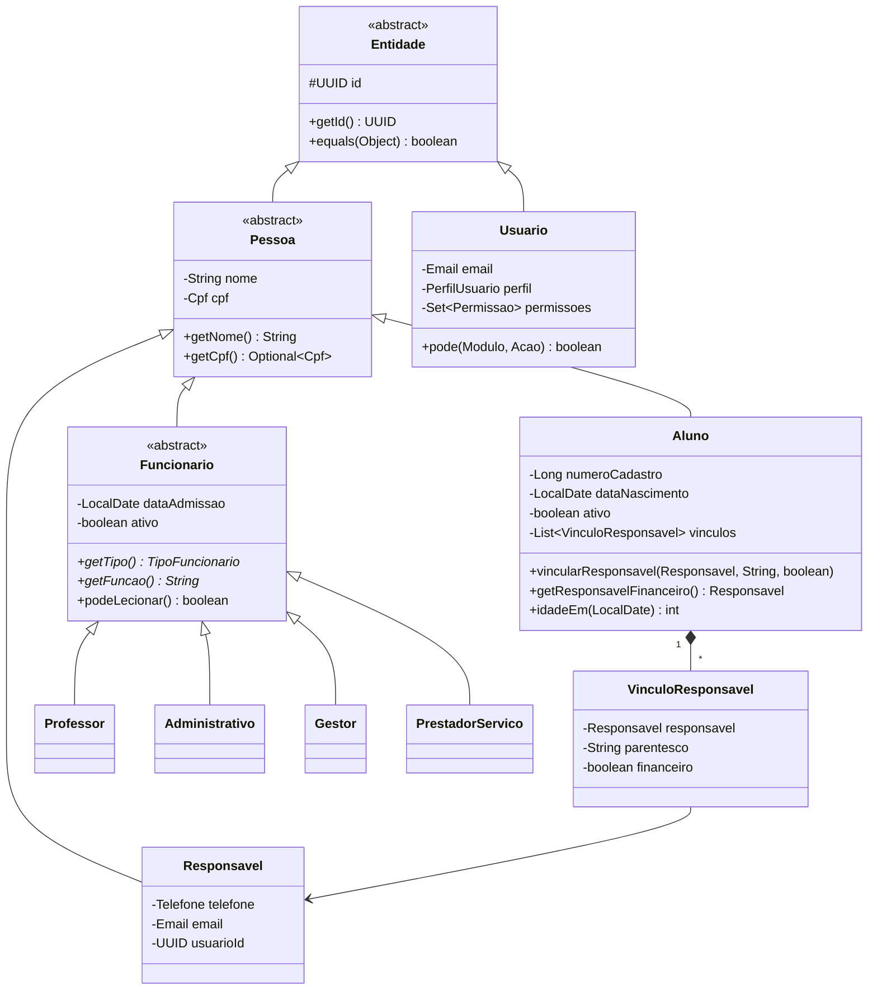
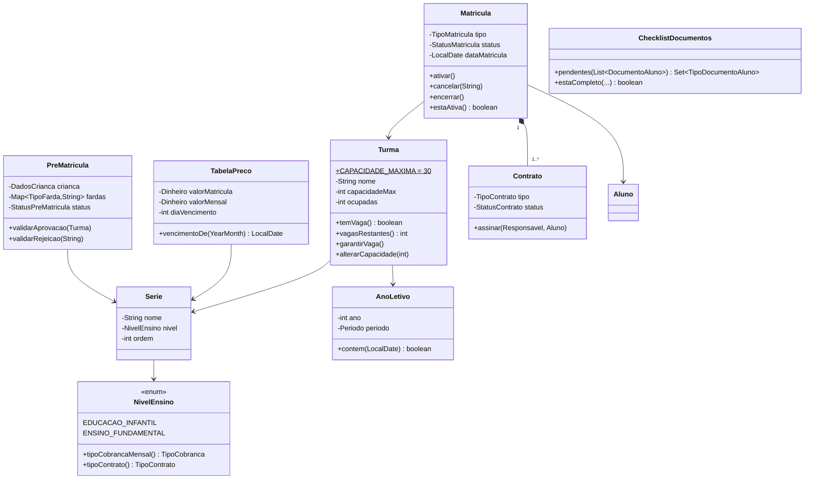
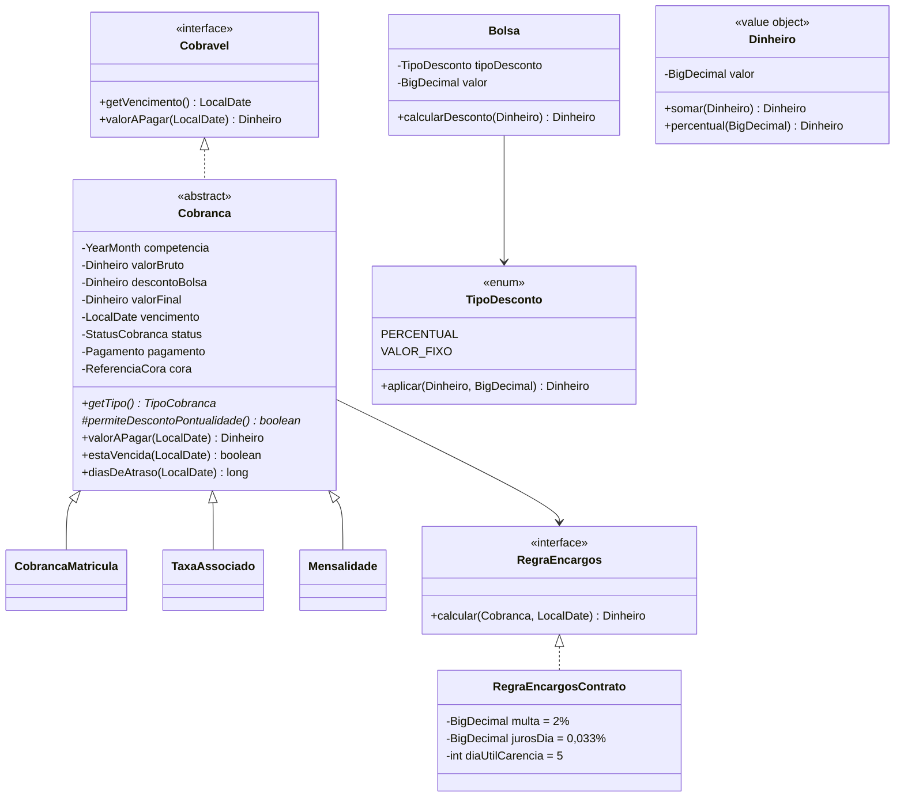
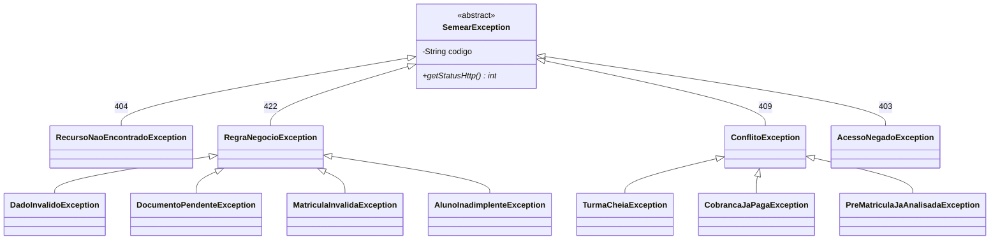

# 04 — Model e Controller (Java, orientado a objetos)

> As camadas **Model** e **Controller** do MVC, em Java. O Model concentra o domínio e as regras do Sistema Semear e é a **única** parte que acessa o banco; os Controllers expõem a API REST consumida pela View ([05-view.md](05-view.md)). Os trechos de código abaixo são **esqueletos de referência** para fixar o desenho; a implementação completa vem nas etapas do [plano](07-plano-e-convencoes.md).

---

## 1. Stack e dependências

| Item | Escolha |
|---|---|
| Linguagem | Java 21 (LTS) |
| Framework | Spring Boot 3.x |
| Build | Maven (`pom.xml` na raiz do projeto) |
| Dependências | `spring-boot-starter-web`, `-validation`, `-jdbc`, `-security`, `-oauth2-resource-server`, `org.postgresql:postgresql`, `springdoc-openapi-starter-webmvc-ui` (Swagger), `spring-boot-starter-test` |
| Sem Lombok | Getters, construtores e `equals` escritos à mão: o encapsulamento fica visível (objetivo da disciplina) |
| Porta | 8080; prefixo `/api` |
| Documentação da API | Swagger em `/swagger-ui.html` (só em dev) |

---

## 2. Organização em pacotes

**Pacotes por camada MVC**, com um subpacote por módulo do domínio dentro de cada camada (`pessoa`, `academico`, `matricula`, `financeiro`, `pedagogico`, `institucional`, `portal`).

```
src/main/java/br/undb/semear/
├── SemearApplication.java
├── config/                         # SupabaseProperties, CorsConfig, JacksonConfig, OpenApiConfig
│
├── controller/                     # ───── CONTROLLER ─────
│   ├── advice/                     # GlobalExceptionHandler, ErroResponse
│   ├── pessoa/                     # AlunoController, ResponsavelController, FuncionarioController, UsuarioController
│   ├── academico/                  # TurmaController, AnoLetivoController, TabelaPrecoController...
│   ├── matricula/                  # PreMatriculaController, MatriculaController
│   ├── financeiro/                 # CobrancaController, BolsaController, CoraWebhookController
│   ├── pedagogico/                 # DiarioController, PlanoAulaController, NotaController
│   ├── institucional/              # ObrigacaoController
│   └── portal/                     # PortalController
│
├── dto/                            # entrada/saída dos controllers (records), mesmos subpacotes
│   └── matricula/                  # ex.: AprovarPreMatriculaRequest, PreMatriculaResponse
│
├── service/                        # ───── MODEL: casos de uso ─────
│   ├── pessoa/                     # AlunoService, FuncionarioService, UsuarioService
│   ├── academico/  matricula/  financeiro/  pedagogico/  institucional/  portal/
│
├── model/                          # ───── MODEL: domínio (Java puro) ─────
│   ├── entity/
│   │   ├── pessoa/                 # Entidade, Pessoa, Aluno, Responsavel, VinculoResponsavel,
│   │   │                           # Funcionario, Professor, Administrativo, Gestor, PrestadorServico, Usuario
│   │   ├── academico/              # AnoLetivo, Serie, Turma, Disciplina, TabelaPreco, ListaMaterial
│   │   ├── matricula/              # PreMatricula, Matricula, Farda, Contrato, DocumentoAluno, ChecklistDocumentos
│   │   ├── financeiro/             # Cobravel, Cobranca, CobrancaMatricula, TaxaAssociado, Mensalidade,
│   │   │                           # Bolsa, Pagamento, RegraEncargos, RegraEncargosContrato, NotificacaoCobranca
│   │   ├── pedagogico/             # DiarioClasse, Frequencia, PlanoAula, CalendarioLetivo, Nota, FormacaoContinuada
│   │   └── institucional/          # ObrigacaoInstitucional
│   ├── enums/                      # os 20 enums do banco + Modulo, Acao
│   ├── valueobject/                # Dinheiro, Cpf, Email, Telefone, Periodo, ValorNota, CalendarioDiasUteis
│   └── exception/                  # SemearException e hierarquia
│
├── repository/                     # ───── MODEL: persistência ─────
│   ├── base/                       # Repository<T,ID>, JdbcRepository<T>, TradutorErroBanco
│   ├── pessoa/                     # AlunoRepository (interface) + AlunoJdbcRepository ...
│   ├── academico/  matricula/  financeiro/  pedagogico/  institucional/
│   └── portal/                     # consultas de leitura sobre as views vw_portal_*
│
├── security/                       # SecurityConfig, UsuarioLogado, PermissaoEvaluator
└── integration/
    ├── supabase/                   # SupabaseAuthAdmin, SupabaseStorage
    ├── cora/                       # CoraGateway (interface), CoraGatewayFalso, CoraGatewayHttp
    └── notificacao/                # Notificador (interface), NotificadorLog, NotificadorEmail, NotificadorFactory

src/test/java/br/undb/semear/
├── model/                          # testes unitários das regras (rn04_..., rn08_...)
├── service/                        # com repositórios em memória
└── controller/                     # MockMvc
```

**Nomes:** camadas e sufixos técnicos em inglês (`*Controller`, `*Service`, `*Repository`, `*JdbcRepository`, `*Request`, `*Response`, `*Exception`); domínio em português (`Matricula`, `Cobranca`, `valorAPagar`).

Regras de dependência (ver [02-arquitetura.md §1](02-arquitetura.md#1-padrão-mvc)):
- `model` não importa nada de Spring, JDBC ou HTTP;
- `controller` só fala com `service` e `dto`; nunca com `repository`;
- `service` usa as **interfaces** de `repository`, nunca a classe JDBC diretamente;
- um módulo usa outro pelo `service` dele.

---

## 3. Modelo de domínio

O banco tem três tabelas de pessoa separadas; no Java elas compartilham a superclasse abstrata `Pessoa` (herança só no código — decisão D04).

### 3.1 Pessoas



### 3.2 Acadêmico e matrícula



### 3.3 Financeiro (ponto central de polimorfismo)



| Subclasse | `getTipo()` | `permiteDescontoPontualidade()` |
|---|---|---|
| `CobrancaMatricula` | `MATRICULA` | `false` |
| `TaxaAssociado` | `TAXA_ASSOCIADO` | `false` (tabela não prevê desconto) |
| `Mensalidade` | `MENSALIDADE` | `true` (RN08) |

### 3.4 Pedagógico e institucional

- `DiarioClasse` (turma, professor, data, conteúdo) com `registrarPresenca(Matricula, boolean, String)`; valida que a matrícula está ativa.
- `Frequencia`, `PlanoAula` (`TipoPlano`), `CalendarioLetivo`, `FormacaoContinuada`, `Nota` (value object `ValorNota` 0–10, bimestre 1–4).
- `ObrigacaoInstitucional`: `estaAtrasada(hoje)`, `deveAlertar(hoje)` (dentro da antecedência), `cumprir(hoje)` (reprograma pela periodicidade ou marca cumprida).

---

## 4. POO aplicada

### 4.1 Pilares

| Conceito | Onde aparece |
|---|---|
| **Abstração** | `Entidade`, `Pessoa`, `Funcionario`, `Cobranca` são abstratas; interfaces `Cobravel`, `Repository<T,ID>`, `RegraEncargos`, `CoraGateway`, `Notificador` |
| **Encapsulamento** | Atributos `private`; sem setters públicos genéricos; mudança de estado só por métodos com regra (`matricula.ativar()`, `turma.alterarCapacidade(n)`); construtores rejeitam estado inválido; coleções expostas como `List.copyOf` |
| **Herança** | `Pessoa → Aluno/Responsavel/Funcionario → Professor/Administrativo/Gestor/PrestadorServico`; `Cobranca → CobrancaMatricula/TaxaAssociado/Mensalidade`; `SemearException → ...` |
| **Polimorfismo** | `Cobranca.getTipo()` e `permiteDescontoPontualidade()`; `Funcionario.getFuncao()` e `podeLecionar()`; `TipoDesconto.aplicar()`; `NivelEnsino.tipoCobrancaMensal()`; repositório JDBC × em memória atrás da mesma interface |
| **Composição** | `Aluno` *compõe* `VinculoResponsavel`; `Cobranca` compõe `Pagamento` e `ReferenciaCora`; value objects `Cpf`, `Email`, `Telefone`, `Dinheiro`, `Periodo` |
| **Interfaces** | `Repository<T,ID>`, `Cobravel`, `RegraEncargos`, `CoraGateway`, `Notificador`, `ArmazenamentoArquivos` |
| **Exceções próprias** | `TurmaCheiaException`, `DocumentoPendenteException`, `MatriculaInvalidaException`, `AlunoInadimplenteException`, … |

### 4.2 Padrões de projeto

| Padrão | Classe(s) | Para quê |
|---|---|---|
| Repository | `Repository<T,ID>` + `*JdbcRepository` / `*InMemoryRepository` | Isolar persistência; testar sem banco |
| Template Method | `Cobranca.valorAPagar()` (passos fixos, ganchos nas subclasses); `JdbcRepository` | Algoritmo comum, variações nas subclasses |
| Strategy | `RegraEncargos`, `TipoDesconto`, `Notificador` | Trocar a regra de multa/juros, o tipo de desconto ou o canal sem mexer em quem usa |
| Factory | `FuncionarioFactory` (por `TipoFuncionario`), `CobrancaFactory` (por `TipoCobranca`), `NotificadorFactory` (por `CanalNotificacao`) | Instanciar a subclasse certa a partir do valor do banco |
| Value Object | `Dinheiro`, `Cpf`, `Email`, `Telefone`, `Periodo`, `ValorNota` | Validação e regras do valor em um único lugar; imutáveis |
| State (via enum) | `StatusMatricula.podeIrPara(...)`, `StatusCobranca` | Transições válidas declaradas no enum |
| Gateway / Adapter | `CoraGateway`, `SupabaseStorage`, `SupabaseAuthAdmin` | Esconder APIs externas atrás de interfaces do domínio |

---

## 5. Esqueletos das classes-chave

### 5.1 Base e value objects

```java
public abstract class Entidade {
    protected final UUID id;
    protected Entidade(UUID id) { this.id = id; }           // null = ainda não persistida
    public UUID getId() { return id; }
    @Override public boolean equals(Object o) {
        return o instanceof Entidade e && id != null && id.equals(e.id);
    }
    @Override public int hashCode() { return Objects.hashCode(id); }
}

public final class Dinheiro implements Comparable<Dinheiro> {
    public static final Dinheiro ZERO = new Dinheiro(BigDecimal.ZERO);
    private static final RoundingMode ARREDONDAMENTO = RoundingMode.HALF_EVEN; // decisão pendente (01 §8)
    private final BigDecimal valor;
    private Dinheiro(BigDecimal v) { this.valor = v.setScale(2, ARREDONDAMENTO); }
    public static Dinheiro de(String v) { return new Dinheiro(new BigDecimal(v)); }
    public Dinheiro somar(Dinheiro o) { return new Dinheiro(valor.add(o.valor)); }
    public Dinheiro subtrair(Dinheiro o) { return new Dinheiro(valor.subtract(o.valor)); }
    public Dinheiro percentual(BigDecimal pct) { return new Dinheiro(valor.multiply(pct).divide(BigDecimal.valueOf(100))); }
    // compareTo, equals, hashCode, toString("R$ 0,00")
}

public final class Cpf {                     // só dígitos; valida dígito verificador
    private final String digitos;
    public Cpf(String entrada) { /* remove máscara, valida, lança DadoInvalidoException */ }
    @Override public String toString() { return "***.***.***-" + digitos.substring(9); } // LGPD
}
```

### 5.2 Pessoas e fábrica

```java
public abstract class Funcionario extends Pessoa {
    private LocalDate dataAdmissao;
    private boolean ativo;
    public abstract TipoFuncionario getTipo();
    public abstract String getFuncao();
    public boolean podeLecionar() { return false; }
}

public final class Professor extends Funcionario {
    @Override public TipoFuncionario getTipo() { return TipoFuncionario.PROFESSOR; }
    @Override public String getFuncao() { return "Professor(a)"; }
    @Override public boolean podeLecionar() { return true; }
}

public final class FuncionarioFactory {
    public static Funcionario criar(TipoFuncionario tipo, DadosFuncionario d) {
        return switch (tipo) {
            case PROFESSOR         -> new Professor(d);
            case ADMINISTRATIVO    -> new Administrativo(d);
            case GESTOR            -> new Gestor(d);
            case PRESTADOR_SERVICO -> new PrestadorServico(d);
        };
    }
}
```

### 5.3 Turma (RN04 é regra da própria turma)

```java
public class Turma extends Entidade {
    public static final int CAPACIDADE_MAXIMA = 30;
    private final Serie serie;
    private final AnoLetivo anoLetivo;
    private final String nome;
    private int capacidadeMax;
    private int ocupadas;                        // vem de vw_vagas_turma

    public boolean temVaga() { return ocupadas < capacidadeMax; }
    public int vagasRestantes() { return Math.max(0, capacidadeMax - ocupadas); }
    public void garantirVaga() {
        if (!temVaga()) throw new TurmaCheiaException(nome, capacidadeMax);
    }
    public void alterarCapacidade(int nova) {
        if (nova < 1 || nova > CAPACIDADE_MAXIMA) throw new DadoInvalidoException("capacidadeMax", "entre 1 e 30");
        if (nova < ocupadas) throw new RegraNegocioException("CAPACIDADE_ABAIXO_OCUPACAO", "...");
        this.capacidadeMax = nova;
    }
}
```

> `garantirVaga()` dá a mensagem antes de ir ao banco. Sob concorrência, quem decide é o trigger (trava de linha). As duas regras dizem a mesma coisa.

### 5.4 Cobrança (Template Method + Strategy)

```java
public abstract class Cobranca extends Entidade implements Cobravel {
    private static final BigDecimal DESCONTO_PONTUALIDADE = new BigDecimal("10"); // RN08
    private final YearMonth competencia;
    private final Dinheiro valorBruto, descontoBolsa, valorFinal;
    private final LocalDate vencimento;
    private StatusCobranca status;
    private Pagamento pagamento;                 // null enquanto não pago
    private final RegraEncargos regraEncargos;

    public abstract TipoCobranca getTipo();
    protected abstract boolean permiteDescontoPontualidade();

    @Override
    public final Dinheiro valorAPagar(LocalDate data) {            // template: ordem fixa
        if (status == StatusCobranca.PAGO) return pagamento.valorPago();
        if (!data.isAfter(vencimento) && permiteDescontoPontualidade())
            return valorFinal.subtrair(valorFinal.percentual(DESCONTO_PONTUALIDADE));
        return valorFinal.somar(regraEncargos.calcular(this, data)); // zero dentro da carência
    }
    public boolean estaVencida(LocalDate hoje) {
        return (status == StatusCobranca.PENDENTE || status == StatusCobranca.VENCIDO) && hoje.isAfter(vencimento);
    }
}

public final class Mensalidade extends Cobranca {
    @Override public TipoCobranca getTipo() { return TipoCobranca.MENSALIDADE; }
    @Override protected boolean permiteDescontoPontualidade() { return true; }
}

public final class RegraEncargosContrato implements RegraEncargos {   // RN09
    private static final BigDecimal MULTA = new BigDecimal("2");
    private static final BigDecimal JUROS_DIA = new BigDecimal("0.033");
    private final CalendarioDiasUteis calendario;
    @Override public Dinheiro calcular(Cobranca c, LocalDate data) {
        LocalDate carencia = calendario.enesimoDiaUtil(YearMonth.from(c.getVencimento()), 5);
        if (!data.isAfter(carencia)) return Dinheiro.ZERO;
        long dias = ChronoUnit.DAYS.between(c.getVencimento(), data);
        return c.getValorFinal().percentual(MULTA)
                .somar(c.getValorFinal().percentual(JUROS_DIA.multiply(BigDecimal.valueOf(dias))));
    }
}
```

> Os percentuais começam como constantes; quando existir a tabela `parametro_financeiro` ([03 §14](03-banco-de-dados.md#14-lacunas-entre-o-domínio-e-o-banco)), a `RegraEncargosContrato` passa a recebê-los no construtor — nenhuma outra classe muda.

### 5.5 Serviço de fluxo (chama a função do banco)

```java
@Service
public class PreMatriculaService {
    private final PreMatriculaRepository preMatriculas;
    private final TurmaRepository turmas;
    private final FluxoMatriculaRepository fluxo;     // chama as fn_* do banco (repository)

    @Transactional
    public UUID aprovar(UUID preMatriculaId, UUID turmaId, UsuarioLogado quem) {
        PreMatricula pre = preMatriculas.buscarPorId(preMatriculaId).orElseThrow(...);
        Turma turma = turmas.buscarPorId(turmaId).orElseThrow(...);
        pre.validarAprovacao(turma);             // status PENDENTE, mesma série/ano
        turma.garantirVaga();                    // RN04 (feedback rápido)
        return fluxo.aprovarPreMatricula(preMatriculaId, quem.funcionarioId(), turmaId);
    }
}
```

---

## 6. Persistência

```java
public interface Repository<T extends Entidade, ID> {
    Optional<T> buscarPorId(ID id);
    List<T> listar();
    T salvar(T entidade);         // insert se id == null, senão update
    void remover(ID id);
}

public interface TurmaRepository extends Repository<Turma, UUID> {
    List<Turma> listarPorAnoLetivo(int ano);
}
```

- **`JdbcRepository<T>`** (abstrata, Template Method): guarda o `JdbcClient` e o nome da tabela, implementa `buscarPorId`, `listar` e `remover`; as subclasses implementam `mapear(ResultSet)`, `inserir(T)` e `atualizar(T)`.
- **`FluxoMatriculaRepository`, `FluxoFinanceiroRepository`, `FluxoInstitucionalRepository`**: classes de `repository/` que chamam as funções `fn_*` (ex.: `jdbc.sql("SELECT fn_aprovar_pre_matricula(?,?,?)").params(...).query(UUID.class).single()`).
- **Leituras de tela** usam as views (`vw_*`) e devolvem DTOs/records de leitura, sem passar por entidades.
- **Enums**: gravados como texto (`stringtype=unspecified` na URL); lidos com `Enum.valueOf`.
- **Repositórios em memória** (`*InMemoryRepository`, `Map<UUID,T>`) para testes de serviço — mesma interface, outra implementação.
- **Transações**: `@Transactional` no serviço. As funções `fn_*` já são atômicas; o `@Transactional` garante que a leitura de validação e a chamada fiquem juntas.

---

## 7. Exceções e tratamento de erros

### 7.1 Hierarquia



### 7.2 Tradução dos erros do banco

`TradutorErroBanco` recebe a `DataAccessException` do Spring, extrai a `PSQLException` (SQLSTATE + mensagem) e devolve a `SemearException` correta pela tabela de [03-banco-de-dados.md §11](03-banco-de-dados.md#11-erros-que-o-banco-devolve). Cada repositório/fluxo JDBC envolve suas chamadas com o tradutor; serviços e controllers só veem exceções do domínio.

### 7.3 Formato de erro da API

`GlobalExceptionHandler` (`@RestControllerAdvice`) devolve sempre:

```json
{
  "status": 409,
  "codigo": "TURMA_LOTADA",
  "mensagem": "A turma \"1º Ano A\" atingiu o limite de 30 alunos.",
  "campos": [],
  "instante": "2027-02-03T10:15:00Z"
}
```

- Erros de validação de entrada (`@Valid`) → 400, `codigo = "ENTRADA_INVALIDA"`, `campos = [{ "campo": "cpf", "mensagem": "CPF inválido" }]`.
- Erro inesperado → 500, `codigo = "ERRO_INTERNO"`, mensagem genérica; detalhes só no log (sem dados pessoais).
- A View decide a mensagem pelo `codigo`, não pelo texto.

---

## 8. Segurança e autorização

1. **Autenticação**: Spring Security como OAuth2 Resource Server valida o JWT do Supabase (assinatura via JWKS, `iss = <SUPABASE_URL>/auth/v1`, `aud = authenticated`, expiração). Detalhes em [06-supabase-conexao.md §5](06-supabase-conexao.md#5-configurar-a-aplicação-java).
2. **Usuário logado**: um conversor lê o `sub` do token, carrega `usuario` + `perfil_permissao` (com cache curto) e monta o `UsuarioLogado` (id, perfil, permissões, `funcionarioId`/`responsavelId`/`alunoId` quando houver). Usuário inexistente ou `ativo = false` → 403.
3. **Permissão por módulo**: anotação nos controllers, ex. `@PreAuthorize("@permissoes.pode('MATRICULA', 'GRAVAR')")`. Enums `Modulo` (13 módulos do banco, incluindo `PENDENCIAS`) e `Acao` (LER, GRAVAR).
4. **Filtro por dono do dado** (sempre no serviço, nunca confiando em parâmetro vindo do front):
   - `RESPONSAVEL`/`ALUNO`: só `aluno_id` presentes em `vw_portal_acesso` para o seu `usuario_id`;
   - `PROFESSOR`: só turmas de `turma_professor` do seu `funcionario_id`.
5. **Rotas públicas**: apenas `GET /api/saude`, `POST /api/publico/contas` (limitada por IP) e `POST /api/webhooks/cora` (este valida a assinatura/segredo do Cora).
8. **Perfis editáveis**: as permissões são lidas do banco a cada requisição, então uma mudança feita pelo gestor em *Perfis de acesso* vale na hora (D11).
6. **CORS**: só a origem da View em desenvolvimento (`CORS_ORIGENS`); em produção a View é servida pela própria aplicação.
7. **LGPD**: nada de CPF, saúde ou dados financeiros em logs; `toString()` mascarado; respostas do portal só com o necessário.

---

## 9. Jobs e integrações

| Job / integração | Onde roda | O que faz |
|---|---|---|
| Rotina diária (vencidas, notificações, obrigações) | `pg_cron` → `fn_rotina_diaria()` | — |
| Geração mensal de cobranças (dia 25) | `pg_cron` → `fn_gerar_cobrancas_mensais` | — |
| Emissão de boletos | Service com `@Scheduled` (a cada 15 min) | Busca cobranças `PENDENTE` sem `cora_id` → `CoraGateway.emitir()` → grava `cora_id`, `cora_url`, `cora_sincronizado_em` |
| Webhook de pagamento | `POST /api/webhooks/cora` | Valida assinatura → `fn_registrar_pagamento_cora`; "já está paga" = sucesso (reentrega) |
| Envio de notificações | Service com `@Scheduled` (a cada 10 min) | Lê `notificacao_cobranca` `PENDENTE` com `FOR UPDATE SKIP LOCKED` → `NotificadorFactory.para(canal).enviar()` → `ENVIADA`/`FALHA` |
| Upload/download de arquivos | `SupabaseStorage` (implementa `ArmazenamentoArquivos`) | Upload com chave secreta; download por URL assinada |
| Criação de usuários | `SupabaseAuthAdmin` | Convite por e-mail via Admin API; insere `usuario` com o mesmo id |

Na primeira entrega, `CoraGateway` e `Notificador` têm implementações **falsas** (`CoraGatewayFalso` gera um id e uma URL fictícios; `NotificadorLog` só registra). A troca pela real é só uma nova classe que implementa a mesma interface.

---

## 10. Endpoints da API

Convenções: JSON, `camelCase`, datas ISO-8601, dinheiro como string decimal (`"375.00"`), listas paginadas com `?pagina=0&tamanho=20`. Coluna **Permissão** = módulo:ação exigida.

### 10.1 Sessão e usuários

| Método | Rota | Permissão | Descrição |
|---|---|---|---|
| GET | `/api/me` | autenticado | Dados do usuário logado, perfil e permissões (monta o menu) |
| GET | `/api/usuarios` ✅ | USUARIOS:L | Logins com o cadastro ligado (funcionário, responsável) |
| GET | `/api/usuarios/funcionarios-sem-login` ✅ | USUARIOS:G | Funcionários ativos ainda sem acesso |
| POST | `/api/usuarios` ✅ | USUARIOS:G | `{ funcionarioId, email, perfil }` → conta no Auth já confirmada + `usuario` + vínculo; devolve a **senha provisória** (uma vez) |
| PATCH | `/api/usuarios/{id}/perfil` ✅ | USUARIOS:G | Perfil compatível com o cadastro (Professor só para funcionário professor); não a si mesmo; sempre sobra um ADMIN |
| PATCH | `/api/usuarios/{id}/ativo` ✅ | USUARIOS:G | Desativa/reativa (o desativado recebe 403 `ACESSO_DESATIVADO` ao entrar) |
| POST | `/api/usuarios/{id}/senha-temporaria` ✅ | USUARIOS:G | Gera nova senha provisória (substitui a recuperação por e-mail, D10) |
| POST | `/api/publico/contas` ✅ | público (5/h por IP) | Cria a conta do responsável já confirmada (D10); a View entra em seguida |
| GET | `/api/permissoes` ✅ | CONFIGURACOES:L | Matriz perfil × módulo (perfis de acesso) |
| PUT | `/api/permissoes/{perfil}/{modulo}` ✅ | CONFIGURACOES:G | Corpo `{ler, gravar}`; gravar implica ler; ADMIN mantém Configurações e Usuários (`PERMISSAO_ESSENCIAL`) |
| POST | `/api/permissoes/restaurar-padrao` ✅ | CONFIGURACOES:G | Volta a matriz para `perfil_permissao_padrao` |

### 10.2 Pessoas

| Método | Rota | Permissão | Descrição |
|---|---|---|---|
| GET | `/api/alunos?busca=&ano=&turmaId=&pagina=&tamanho=` ✅ | ALUNOS:L | Alunos matriculados no ano (padrão: ano corrente); professor só vê os das suas turmas |
| GET | `/api/alunos/{id}` ✅ | ALUNOS:L | Ficha: responsáveis (vínculos) e histórico de matrículas |
| PUT | `/api/alunos/{id}/responsavel-financeiro` ✅ | ALUNOS:G | `{ responsavelId }` — RD01 (regra em `Aluno.definirResponsavelFinanceiro`) |
| GET | `/api/alunos/{id}/documentos` ✅ | DOCUMENTOS:L | Checklist RN12 (7 itens, pendentes, arquivos enviados) |
| POST | `/api/alunos/{id}/documentos` ✅ | DOCUMENTOS:G | Multipart `tipo` + `arquivo` (PDF/JPG/PNG ≤ 5 MB, conferido pelo conteúdo) |
| GET | `/api/documentos/{id}/link` ✅ | DOCUMENTOS:L | Link temporário (5 min) do Storage privado |
| DELETE | `/api/documentos/{id}` ✅ | DOCUMENTOS:G | Apaga do banco e do Storage |
| GET | `/api/pendencias/documentos` ✅ | PENDENCIAS:L | Alunos com matrícula vigente (aguardando pagamento ou ativa, ano corrente em diante) e documentos obrigatórios faltando, com o responsável financeiro para cobrança |
| GET | `/api/pendencias/resumo` ✅ | PENDENCIAS:L | Totais para o card do painel |
| GET | `/api/responsaveis?busca=&pagina=&tamanho=` ✅ | ALUNOS:L | Busca por nome ou CPF (bloqueado para professor) |
| GET | `/api/responsaveis/{id}` ✅ | ALUNOS:L | Dados e alunos vinculados |
| PUT | `/api/responsaveis/{id}/contato` ✅ | ALUNOS:G | `{ telefone, email }` — ao menos um contato |
| GET | `/api/funcionarios?busca=&tipo=` ✅ | RH:L | Lista; `funcao` vem do polimorfismo das subclasses |
| GET · POST · PUT | `/api/funcionarios[/{id}]` ✅ | RH:L/G | Detalhe, cadastro (CPF e tipo fixos depois), edição |
| PATCH | `/api/funcionarios/{id}/ativo` ✅ | RH:G | `{ ativo }` |
| GET/POST | `/api/funcionarios/{id}/formacoes` | RH:L/G | Formação continuada |

✅ = implementado (Etapa 1).

### 10.3 Acadêmico

| Método | Rota | Permissão | Descrição |
|---|---|---|---|
| GET | `/api/anos-letivos` · `/api/anos-letivos/corrente` ✅ | TURMAS:L ou ALUNOS:L | Anos letivos; o corrente é o em andamento (ou o último iniciado) |
| POST | `/api/anos-letivos` | CONFIGURACOES:G | Cadastro de ano letivo |
| POST | `/api/anos-letivos/{id}/encerrar` | CONFIGURACOES:G | `fn_encerrar_ano_letivo` |
| GET | `/api/series` | autenticado | Séries (carga fixa) |
| GET | `/api/turmas?ano=` ✅ | TURMAS:L | Turmas com ocupação; professor só vê as suas |
| GET | `/api/turmas/{id}` ✅ | TURMAS:L | Turma, alunos que ocupam vaga e professores |
| PATCH | `/api/turmas/{id}/capacidade` ✅ | TURMAS:G | `{ capacidade }` — RN04 (1 a 30, nunca abaixo da ocupação) |
| POST · DELETE | `/api/turmas[/{id}]` ✅ | TURMAS:G | Criar `{ ano, serieId, nome, capacidade }`; apagar só sem alunos |
| GET | `/api/turmas/opcoes-professores` ✅ | TURMAS:G | Professores ativos e disciplinas |
| POST · DELETE | `/api/turmas/{id}/professores[/{vinculoId}]` ✅ | TURMAS:G | Regente (sem disciplina, um por turma) ou especialista (um por disciplina) |
| POST · PUT | `/api/anos-letivos[/{ano}]` ✅ | CONFIGURACOES:G | Abrir ano / ajustar datas (dentro do próprio ano) |
| GET · PUT | `/api/tabela-precos[?ano=]` ✅ | CONFIGURACOES:L (ou FINANCEIRO:L) / CONFIGURACOES:G | Preço por série: matrícula, mensal, vencimento (1–28), prazo |
| POST | `/api/tabela-precos/copiar` ✅ | CONFIGURACOES:G | `{ deAno, paraAno, reajustePercentual }` — só séries sem preço |
| GET/POST/DELETE | `/api/turmas/{id}/professores` | TURMAS:L/G | Vínculo professor/disciplina |
| GET/PUT | `/api/tabela-precos` | FINANCEIRO:L / CONFIGURACOES:G | Preços por série/ano |
| GET/PUT | `/api/listas-materiais/{serieId}/{ano}` | TURMAS:L/G | Lista de materiais |
| GET · PATCH | `/api/alertas?apenasNaoLidos=` · `/api/alertas/{id}/lido` ✅ | TURMAS:G ou MATRICULA:L / TURMAS:G | Alertas de turma lotada |

### 10.4 Matrícula

| Método | Rota | Permissão | Descrição |
|---|---|---|---|
| GET | `/api/pre-matriculas?status=&ano=` ✅ | MATRICULA:L | Fila (pendentes das mais antigas para as mais novas) |
| GET | `/api/pre-matriculas/{id}` ✅ | MATRICULA:L | Detalhe + turmas da série/ano com ocupação |
| POST | `/api/pre-matriculas/{id}/aprovar` ✅ | MATRICULA:G | `{ turmaId }`: `PreMatricula.validarAprovacao` (RD04, RN04) → `fn_aprovar_pre_matricula` |
| POST | `/api/pre-matriculas/{id}/rejeitar` ✅ | MATRICULA:G | `{ motivo }` (mín. 10 caracteres) → `fn_rejeitar_pre_matricula` |
| GET | `/api/matriculas?busca=&ano=&status=&pagina=` ✅ | MATRICULA:L | Listagem |
| GET | `/api/matriculas/{id}` ✅ | MATRICULA:L | Contratos, fardas, cobrança de matrícula, débitos vencidos |
| POST | `/api/matriculas/{id}/cancelar` ✅ | MATRICULA:G | `{ motivo }`; `Matricula.cancelar` exige quitação (RN13); cobranças futuras canceladas |
| POST | `/api/matriculas/{id}/pagamento-matricula` ✅ | FINANCEIRO:G | `{ origem }` → `fn_registrar_pagamento`; o banco ativa a matrícula (RD02) |
| GET | `/api/matriculas/rematricula/opcoes?alunoId=` ✅ | MATRICULA:L | Situação (`Rematricula.avaliar`) e turma sugerida |
| POST | `/api/matriculas/rematricula` ✅ | MATRICULA:G | `{ alunoId, fardaUniforme, fardaEdFisica }`; turma escolhida pelo Model → `fn_rematricular` |

### 10.5 Financeiro

| Método | Rota | Permissão | Descrição |
|---|---|---|---|
| GET | `/api/cobrancas?ano=&mes=&tipo=&status=&busca=&matriculaId=` ✅ | FINANCEIRO:L | Listagem paginada; `status` é o real na data (pendente vencida = VENCIDO) e `valorHoje` já vem calculado |
| GET | `/api/cobrancas/{id}?data=AAAA-MM-DD` ✅ | FINANCEIRO:L | Detalhe + composição do valor na data (desconto de 10%, multa, juros) |
| POST | `/api/cobrancas/geracao` ✅ | FINANCEIRO:G | `{ ano, mesInicio, mesFim }` → `fn_gerar_cobrancas_periodo` e emissão dos boletos |
| GET | `/api/contratos/{id}` ✅ | MATRICULA:L | Termo para imprimir |
| POST | `/api/contratos/{id}/assinatura` ✅ | MATRICULA:G | Assinatura feita na secretaria `{ responsavelId }` (RD03) |
| GET | `/api/series` ✅ | MATRICULA:L ou TURMAS:L | Séries em ordem |
| GET | `/api/materiais?serieId=&ano=` ✅ | MATRICULA:L | Lista de materiais (RF06) |
| POST · PUT · DELETE | `/api/materiais/itens[/{id}]` ✅ | MATRICULA:G | Itens (sem repetir descrição) |
| POST | `/api/materiais/copiar` ✅ | MATRICULA:G | Copia a lista de outro ano para uma lista vazia |
| POST | `/api/cobrancas/{id}/pagamento` ✅ | FINANCEIRO:G | Baixa **presencial** pelo valor do dia (calculado pelo Model) → `fn_registrar_pagamento` |
| GET | `/api/financeiro/inadimplencia` ✅ | FINANCEIRO:L | Por aluno: cobranças vencidas, maior atraso, valor original e atualizado |
| GET | `/api/financeiro/resumo?ano=` ✅ | FINANCEIRO:L | `vw_resumo_financeiro_mensal` somada por mês + total do ano |
| GET/POST/PUT | `/api/bolsas[/{id}]` ✅ | BOLSAS:L/G | Tipos de bolsa (com bolsistas vigentes) |
| GET | `/api/bolsas/bolsistas?ano=` ✅ | BOLSAS:L | Concessões do ano |
| GET/POST | `/api/matriculas/{id}/bolsas` ✅ | BOLSAS:L/G | Conceder `{ bolsaId }` até o fim do ano letivo; o trigger recalcula as cobranças em aberto |
| DELETE | `/api/matriculas/{id}/bolsas/{concessaoId}` ✅ | BOLSAS:G | Revoga a partir de hoje (apaga se ainda não começou) |
| POST | `/api/webhooks/cora` ✅ | assinatura HMAC | `{"evento":"boleto.pago","id":"cora_..."}` com `X-Cora-Assinatura` = HMAC-SHA256 hex do corpo; reentrega = 200 `JA_ESTAVA_PAGA` |

### 10.6 Pedagógico ✅

Ler: PEDAGOGICO:L (professor só nas suas turmas). Gravar diário, planos e notas: PEDAGOGICO:G **e** estar vinculado à turma (RD07, `ProfessoresDaTurma`).

| Método | Rota | Permissão | Descrição |
|---|---|---|---|
| GET | `/api/pedagogico/turmas?ano=` ✅ | PEDAGOGICO:L | Turmas (do professor ou todas), o que o logado leciona, último diário, bimestre atual |
| GET | `/api/turmas/{id}/chamada?data=` ✅ | PEDAGOGICO:L | Alunos ativos com a presença do dia, conteúdo e se há aula (calendário) |
| PUT | `/api/turmas/{id}/diarios/{data}` ✅ | PEDAGOGICO:G | Grava ou refaz o diário do dia: conteúdo + chamada completa (sem feriado, fim de semana ou futuro) |
| GET | `/api/turmas/{id}/diarios?mes=AAAA-MM` ✅ | PEDAGOGICO:L | Diários do mês com presentes e faltas |
| GET | `/api/turmas/{id}/frequencia` ✅ | PEDAGOGICO:L | Frequência acumulada por aluno; marca abaixo de 75% (LDB) |
| GET · POST | `/api/turmas/{id}/planos[?de=&ate=]` ✅ | PEDAGOGICO:L/G | Planos de aula e planejamentos diários |
| PUT · DELETE | `/api/planos/{id}` ✅ | PEDAGOGICO:G | Só o autor |
| GET · PUT | `/api/turmas/{id}/notas[?disciplinaId=&bimestre=]` ✅ | PEDAGOGICO:L/G | Notas 0–10 por disciplina e bimestre; especialista só a sua, polivalente as demais; valor nulo apaga |
| GET | `/api/calendario?ano=` ✅ | PEDAGOGICO:L ou CONFIGURACOES:L | Dias marcados |
| POST · DELETE | `/api/calendario[/{id}]` ✅ | CONFIGURACOES:G | Feriado, recesso, evento, dia letivo especial |
| GET · POST · DELETE | `/api/funcionarios/{id}/formacoes[/{formacaoId}]` ✅ | RH:L/G | Formação continuada (RF08.4) |

### 10.7 Institucional ✅

| Método | Rota | Permissão | Descrição |
|---|---|---|---|
| GET · POST · PUT · DELETE | `/api/obrigacoes[/{id}]` ✅ | OBRIGACOES:L/G | Cadastro; apagar só sem histórico |
| GET | `/api/obrigacoes/alertas` ✅ | OBRIGACOES:L | Atrasadas e dentro da antecedência (card do painel) |
| GET | `/api/obrigacoes/responsaveis` ✅ | OBRIGACOES:L | Funcionários ativos |
| POST | `/api/obrigacoes/{id}/cumprir` ✅ | OBRIGACOES:G | Exige comprovante do ciclo (D14) → `fn_cumprir_obrigacao` |
| POST | `/api/obrigacoes/{id}/comprovantes` ✅ | OBRIGACOES:G | Multipart `arquivo` (PDF/JPG/PNG ≤ 5 MB), bucket `obrigacoes` |
| GET · DELETE | `/api/obrigacoes/comprovantes/{id}[/link]` ✅ | OBRIGACOES:L/G | Link de 5 min; apagar só do ciclo atual |
| POST | `/api/anos-letivos/{ano}/encerrar` ✅ | CONFIGURACOES:G | `fn_encerrar_ano_letivo`, só depois do último dia letivo |

### 10.8 Portal (responsável / aluno)

Todas filtram pelo usuário logado (§8.4).

| Método | Rota | Descrição |
|---|---|---|
| POST | `/api/portal/cadastro` ✅ | Primeiro acesso (só exige login): cria `usuario` RESPONSAVEL e cria/vincula `responsavel` pelo CPF |
| GET | `/api/portal/alunos` ✅ | Filhos e matrícula mais recente |
| GET | `/api/portal/opcoes-matricula` ✅ | Anos abertos e séries |
| POST | `/api/portal/pre-matriculas` ✅ | Nova pré-matrícula (idade compatível, fardas válidas, sem duplicar pedido em análise) |
| GET | `/api/portal/rematricula` ✅ | Situação de rematrícula de cada filho |
| POST | `/api/portal/rematricula` ✅ | `{ alunoId, fardas }` — só filhos do responsável logado |
| GET | `/api/portal/alunos/{id}/boletim?ano=` ✅ | Notas por bimestre, média parcial e frequência (padrão: ano letivo em andamento) |
| GET | `/api/portal/alunos/{id}/materiais` ✅ | Lista de materiais da série da matrícula vigente |
| GET | `/api/portal/alunos/{id}/contratos` ✅ | Contrato de Matrícula / Ficha de Sócio do filho |
| GET | `/api/portal/contratos/{id}` ✅ | Termo com as cláusulas preenchidas |
| POST | `/api/portal/contratos/{id}/assinar` ✅ | Aceite eletrônico `{ aceite: true }`; assinante = responsável do login (RD03) |
| GET · POST | `/api/portal/alunos/{id}/documentos` ✅ | Checklist e envio de documentos do filho (só filhos do logado) |
| GET | `/api/portal/documentos/{id}/link` ✅ | Link temporário de um documento do filho |
| GET | `/api/portal/cobrancas` ✅ | Cobranças em que o logado é o **pagador** + `pagamentoSimulado` |
| GET | `/api/portal/cobrancas/{id}` ✅ | Boleto com a composição do valor de hoje |
| POST | `/api/portal/cobrancas/{id}/pagamento-simulado` ✅ | Só com `CORA_MODO=falso`: faz o papel do banco (mesmo caminho do webhook) |
| GET | `/api/portal/pre-matriculas` ✅ | Pré-matrículas enviadas, status e motivo da recusa |

---

## 11. Configuração

`src/main/resources/application.yml` (já criado) (valores vêm de variáveis de ambiente; nada sensível no arquivo):

```yaml
spring:
  config:
    import: optional:file:.env[.properties]     # lê o .env da raiz em desenvolvimento
  datasource:
    url: ${SUPABASE_DB_URL}
    username: ${SUPABASE_DB_USER}
    password: ${SUPABASE_DB_PASSWORD}
    hikari:
      maximum-pool-size: ${DB_POOL_MAX:5}
  security:
    oauth2:
      resourceserver:
        jwt:
          jwk-set-uri: ${SUPABASE_URL}/auth/v1/.well-known/jwks.json

semear:
  supabase:
    url: ${SUPABASE_URL}
    secret-key: ${SUPABASE_SECRET_KEY}
    jwt-issuer: ${SUPABASE_URL}/auth/v1
    jwt-audience: authenticated
  cors:
    origens: ${CORS_ORIGENS:http://localhost:5173}
  cora:
    modo: ${CORA_MODO:falso}                  # falso | sandbox | producao
```

As variáveis estão documentadas em `.env.example` (raiz) e em [06-supabase-conexao.md](06-supabase-conexao.md).

---

## 12. Testes

| Tipo | Ferramenta | Banco | O que cobre |
|---|---|---|---|
| Unitário de domínio | JUnit 5 + AssertJ | nenhum | Toda regra RN/RD implementada em Java |
| Serviço | JUnit 5 + repositórios em memória | nenhum | Orquestração, permissões, RN12/RN13 |
| Integração | JUnit 5 + Spring Boot Test, `@Tag("integracao")` | Supabase local (`supabase start`) | Repositórios JDBC, funções `fn_*`, tradução de erros |
| API | MockMvc | mock dos serviços | Status HTTP, formato de erro, segurança |

Nome do teste referencia a regra: `rn04_naoMatriculaAcimaDe30()`, `rn08_aplicaDescontoDe10PorCentoAteVencimento()`, `rn09_cobraMultaEJurosAposQuintoDiaUtil()`, `rd05_naoAlteraCobrancaPaga()`.

Regras com teste obrigatório desde o início: RN04, RN08, RN09, RN11 (cálculo da bolsa igual ao do banco), RN13, RD01.
