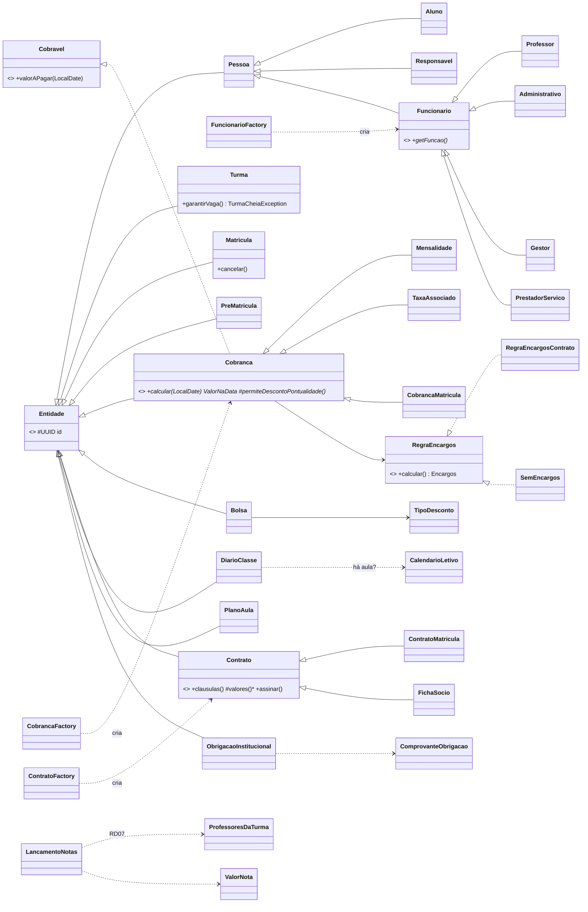

# 08 — Entrega: o que foi construído

Resumo final do **Sistema Semear** (29/10/2026): requisitos atendidos, diagrama de classes do Model, decisões, testes e limitações conhecidas.

## 1. Requisitos atendidos

| Requisito | Situação | Onde está |
|---|---|---|
| RF01 Matrícula e rematrícula (01.1 a 01.6) | ✅ | Portal (pré-matrícula, rematrícula), escola (fila, aprovação com vaga, matrículas, cancelamento) |
| RF01.4 Contrato / Ficha de Sócio | ✅ texto, aceite eletrônico e assinatura presencial; versão para imprimir/salvar em PDF | `/portal/contratos/:id`, `/escola/contratos/:id` |
| RF02 Bolsas | ✅ cadastro, concessão e revogação com recálculo das cobranças em aberto | `/escola/financeiro/bolsas`, detalhe da matrícula |
| RF03 Capacidade de turmas | ✅ até 30 (RN04), alerta de turma lotada | Turmas, painel |
| RF04 Financeiro + Cora | ✅ cobranças, baixa presencial, geração, resumo; Cora **simulado** com webhook | `/escola/financeiro/*`, `/portal/financeiro` |
| RF05 Notificações de cobrança | ✅ fila e envio agendado; envio **simulado** (log) | `AgendamentoFinanceiro` |
| RF06 Lista de materiais | ✅ edição na escola, lista do filho no portal | `/escola/config/materiais` |
| RF07 RH | ✅ funcionários por tipo (herança) + formação continuada | `/escola/rh/funcionarios` |
| RF08 Pedagógico (08.1 a 08.4) | ✅ diário com chamada, planos, calendário, formação; notas e frequência | `/escola/pedagogico` |
| RF09 Obrigações institucionais | ✅ prazos com aviso, comprovante, cumprimento e renovação | `/escola/obrigacoes` |
| RF10 Portal | ✅ filhos, boletim, frequência, documentos, materiais, cobranças, contratos | `/portal` |
| Orientação do prof. Gusmão | ✅ matrícula com pendência sinalizada, aba Pendências no painel, perfis de acesso editáveis com padrão | `/escola/pendencias`, `/escola/config/perfis` |

Regras de negócio: RN01–RN09, RN11–RN13 e RD01–RD07 implementadas e testadas (Model e/ou banco — matriz em [01 §3](01-negocio.md)). **RN10 (INPC)** ficou fora, como previsto.

## 2. Diagrama de classes (Model)

Visão das hierarquias e dos padrões. Atributos e métodos completos estão no código e em [04](04-model-controller.md).

| Conceito / padrão | Exemplo no código |
|---|---|
| Herança + polimorfismo | `Funcionario` (4 tipos), `Cobranca` (3 tipos), `Contrato` (2 tipos) |
| Template Method | `Cobranca.calcular`, `Contrato.clausulas`, `JdbcRepository` |
| Strategy | `RegraEncargos` → `RegraEncargosContrato` |
| Null Object | `SemEncargos` (cobrança de matrícula) |
| Factory | `CobrancaFactory`, `ContratoFactory`, `FuncionarioFactory`, `NotificadorFactory` |
| Adapter / Gateway | `ArmazenamentoArquivos` → `SupabaseStorage`, `CoraGateway` → `CoraGatewayFalso`, `ProvedorIdentidade` → `SupabaseAuthAdmin` |
| Polimorfismo por enum | `NivelEnsino` (cobrança e contrato do nível), `TipoDesconto.aplicar`, `TipoCalendario.temAula` |
| Value Object | `Dinheiro`, `Cpf`, `Email`, `Telefone`, `ValorNota`, `CalendarioDiasUteis`, `ArquivoEnviado` |
| Encapsulamento de regra | `Turma.garantirVaga` (RN04), `Rematricula.avaliar` (RN13), `MatrizPermissoes` (ADMIN não se tranca fora) |

## 3. Decisões tomadas durante o projeto

Registro completo em [02 §7](02-arquitetura.md#7-decisões-de-arquitetura-registro). As principais: MVC num projeto só com View servida pelo Java (D01–D09); conta do portal criada pelo Java já confirmada, por não haver servidor de e-mail (D10); perfis de acesso editáveis (D11); Cora simulado (D12); valor a pagar só no Model (D13); comprovante obrigatório para cumprir obrigação (D14); tarefas agendadas na aplicação em vez do `pg_cron` (D15).

## 4. Testes

- **128 testes Java** (Model e Controllers), entre eles: RN04 (turma lotada), RN08/RN09 (o cálculo bate com o seed: R$ 375,00 pagos 11 dias depois = R$ 383,86), RN11/RD06 (bate com `fn_desconto_bolsa`), RN13, RD03, RD05, RD07, chamada em feriado/fim de semana, nota fora da faixa, assinatura do webhook, perfis de acesso.
- **Testes da View** (formatadores) e checagem de tipos (`npm run typecheck`).
- Cada etapa foi também testada **contra o banco real** com as contas de demonstração; os registros de teste foram desfeitos (exceto 3 pagamentos de teste da Etapa 3, que o banco não deixa apagar — RD05).

## 5. LGPD

- Só dados fictícios (CPFs inventados com dígito válido, e-mails `example.com`).
- Logs sem nome, CPF, e-mail ou telefone (só ids e códigos); `toString()` mascarado nas entidades com dados pessoais.
- Arquivos (documentos e comprovantes) em buckets privados, abertos só por link temporário de 5 minutos.
- Banco com RLS ligado e sem acesso direto do navegador; a chave secreta fica só no servidor.
- Portal filtra tudo pelo responsável do login (filhos e cobranças em que ele é o pagador).

## 6. Limitações e próximos passos

| Item | Situação |
|---|---|
| Tela de **Usuários** (dar login a funcionários) | Não feita: hoje os logins da escola são criados no painel do Supabase e ligados por `supabase/demo_usuarios.sql` |
| Integração real com o Cora | Simulada (D12); a real é uma nova classe de `CoraGateway` |
| Envio real de e-mail/SMS/WhatsApp | Simulado em log; recuperação de senha depende de SMTP próprio |
| Texto oficial do contrato | Resumo das cláusulas citadas no MODELO.md (o CONTRATO.docx não está no repositório) |
| Datas oficiais de bimestre | Ano letivo dividido em 4 partes iguais |
| Correção pelo INPC (RN10) | Fora do escopo |
| Decisões P01–P06 | Provisórias, aguardando o professor ([07 §2](07-plano-e-convencoes.md#2-decisões-pendentes)) |
